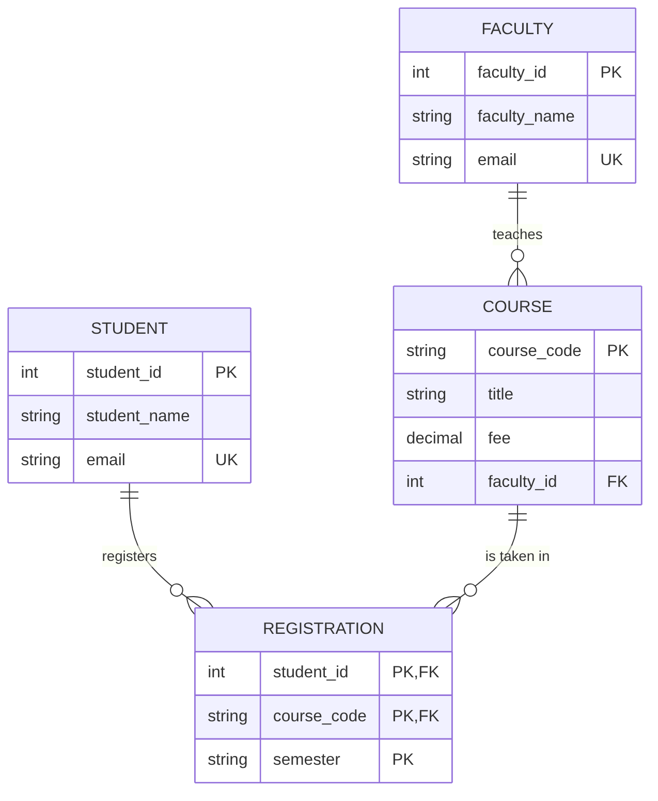

# Normalisation Workshop - college_registrations

## 0. Starting point (unnormalised)

One row per student. Courses, faculty and fees are packed into single cells.

| student_id | student_name | email | courses | faculty | faculty_email | fee | semester |
|---|---|---|---|---|---|---|---|
| 101 | Arun | arun@clg.edu | CS101 Java Programming, MA102 Discrete Maths | Dr. Rao, Dr. Iyer | rao@clg.edu, iyer@clg.edu | 12000, 9000 | 2026-ODD |
| 102 | Divya | divya@clg.edu | CS101 Java Programming | Dr. Rao | rao@clg.edu | 12000 | 2026-ODD |
| 103 | Karthik | karthik@clg.edu | MA102 Discrete Maths, PH103 Physics Lab | Dr. Iyer, Dr. Nair | iyer@clg.edu, nair@clg.edu | 9000, 8000 | 2026-ODD |
| 104 | Meena | meena@clg.edu | CS101 Java Programming, PH103 Physics Lab | Dr. Rao, Dr. Nair | rao@clg.edu, nair@clg.edu | 12000, 8000 | 2026-ODD |

Problems: several values in one cell (repeating groups), so it is not even in 1NF. You cannot search or join on a single course.

## 1. First Normal Form (1NF)

Rule: every cell holds one atomic value and every row is unique.

Fix: one row per student and course. The key becomes (student_id, course_code, semester).

| student_id | student_name | email | course_code | course_title | faculty_name | faculty_email | fee | semester |
|---|---|---|---|---|---|---|---|---|
| 101 | Arun | arun@clg.edu | CS101 | Java Programming | Dr. Rao | rao@clg.edu | 12000 | 2026-ODD |
| 101 | Arun | arun@clg.edu | MA102 | Discrete Maths | Dr. Iyer | iyer@clg.edu | 9000 | 2026-ODD |
| 102 | Divya | divya@clg.edu | CS101 | Java Programming | Dr. Rao | rao@clg.edu | 12000 | 2026-ODD |
| 103 | Karthik | karthik@clg.edu | MA102 | Discrete Maths | Dr. Iyer | iyer@clg.edu | 9000 | 2026-ODD |
| 103 | Karthik | karthik@clg.edu | PH103 | Physics Lab | Dr. Nair | nair@clg.edu | 8000 | 2026-ODD |
| 104 | Meena | meena@clg.edu | CS101 | Java Programming | Dr. Rao | rao@clg.edu | 12000 | 2026-ODD |
| 104 | Meena | meena@clg.edu | PH103 | Physics Lab | Dr. Nair | nair@clg.edu | 8000 | 2026-ODD |

Functional dependencies found:

- student_id -> student_name, email
- course_code -> course_title, faculty_name, faculty_email, fee
- faculty_name -> faculty_email
- (student_id, course_code, semester) -> nothing else, the row itself is the registration

Anomalies in this table:

| Anomaly | Example |
|---|---|
| Update | Dr. Rao's email is stored in 3 rows. Changing it in one row leaves the data inconsistent. |
| Insert | A new course PH201 cannot be added until a student registers for it, because student_id is part of the key. |
| Delete | If the only student of a course withdraws, the course, its fee and its faculty are lost. |

## 2. Second Normal Form (2NF)

Rule: 1NF, and no non-key column depends on only part of a composite key.

Partial dependencies:

- student_name, email depend only on student_id
- course_title, faculty_name, faculty_email, fee depend only on course_code

Fix: split into three tables.

**student**

| student_id (PK) | student_name | email (UK) |
|---|---|---|
| 101 | Arun | arun@clg.edu |
| 102 | Divya | divya@clg.edu |
| 103 | Karthik | karthik@clg.edu |
| 104 | Meena | meena@clg.edu |

**course**

| course_code (PK) | course_title | faculty_name | faculty_email | fee |
|---|---|---|---|---|
| CS101 | Java Programming | Dr. Rao | rao@clg.edu | 12000 |
| MA102 | Discrete Maths | Dr. Iyer | iyer@clg.edu | 9000 |
| PH103 | Physics Lab | Dr. Nair | nair@clg.edu | 8000 |

**registration**

| student_id (PK, FK) | course_code (PK, FK) | semester (PK) |
|---|---|---|
| 101 | CS101 | 2026-ODD |
| 101 | MA102 | 2026-ODD |
| 102 | CS101 | 2026-ODD |
| 103 | MA102 | 2026-ODD |
| 103 | PH103 | 2026-ODD |
| 104 | CS101 | 2026-ODD |
| 104 | PH103 | 2026-ODD |

Anomalies fixed: a course can now exist without students, and a student's details are stored once.

## 3. Third Normal Form (3NF)

Rule: 2NF, and no non-key column depends on another non-key column (no transitive dependency).

Transitive dependency in course: course_code -> faculty_name -> faculty_email. faculty_email depends on the faculty, not on the course.

Fix: move faculty into its own table and reference it from course.

## Final design (3NF)

**student**

| student_id (PK) | student_name | email (UK) |
|---|---|---|
| 101 | Arun | arun@clg.edu |
| 102 | Divya | divya@clg.edu |
| 103 | Karthik | karthik@clg.edu |
| 104 | Meena | meena@clg.edu |

**faculty**

| faculty_id (PK) | faculty_name | email (UK) |
|---|---|---|
| 1 | Dr. Rao | rao@clg.edu |
| 2 | Dr. Iyer | iyer@clg.edu |
| 3 | Dr. Nair | nair@clg.edu |

**course**

| course_code (PK) | title | fee | faculty_id (FK) |
|---|---|---|---|
| CS101 | Java Programming | 12000 | 1 |
| MA102 | Discrete Maths | 9000 | 2 |
| PH103 | Physics Lab | 8000 | 3 |

**registration**

| student_id (PK, FK) | course_code (PK, FK) | semester (PK) |
|---|---|---|
| 101 | CS101 | 2026-ODD |
| 101 | MA102 | 2026-ODD |
| 102 | CS101 | 2026-ODD |
| 103 | MA102 | 2026-ODD |
| 103 | PH103 | 2026-ODD |
| 104 | CS101 | 2026-ODD |
| 104 | PH103 | 2026-ODD |

## Keys and why they were chosen

| Table | Primary key | Other candidate keys | Justification |
|---|---|---|---|
| student | student_id | email | A generated id never changes. Email is unique but people change email addresses, so it is kept as a unique constraint, not the key. |
| faculty | faculty_id | email | Same reasoning as student. |
| course | course_code | - | A short business code that is already unique and stable, so no extra id is needed. |
| registration | (student_id, course_code, semester) | - | The pair of foreign keys identifies a registration, and semester allows the same course to be retaken later. It also blocks duplicate registrations. |

Foreign keys: course.faculty_id -> faculty, registration.student_id -> student, registration.course_code -> course.

## Relationships

| Relationship | Cardinality | How it is implemented |
|---|---|---|
| Faculty teaches Course | 1 : N | faculty_id foreign key in course |
| Student registers for Course | M : N | junction table registration |
| Student - Registration | 1 : N | student_id foreign key in registration |
| Course - Registration | 1 : N | course_code foreign key in registration |

A 1 : 1 relationship would be a student with one profile record. It is implemented with a foreign key that is also unique.

## ER diagram

## 3NF check

| Table | Every non-key column depends on | Result |
|---|---|---|
| student | student_id only | 3NF |
| faculty | faculty_id only | 3NF |
| course | course_code only (faculty details moved out) | 3NF |
| registration | no non-key columns | 3NF |

## RDBMS or NoSQL

| Use an RDBMS when | Use NoSQL when |
|---|---|
| Data has clear relationships and must stay consistent, as with registrations and fees | The structure changes often or each record has a different shape |
| Transactions and joins are needed | Very large volumes need horizontal scaling and simple lookups by key |
| Reports and ad hoc queries are common | Data is a document, a cache, a graph or a time series |

This design uses an RDBMS because registrations link students, courses and faculty, and updates must not leave inconsistent data.
